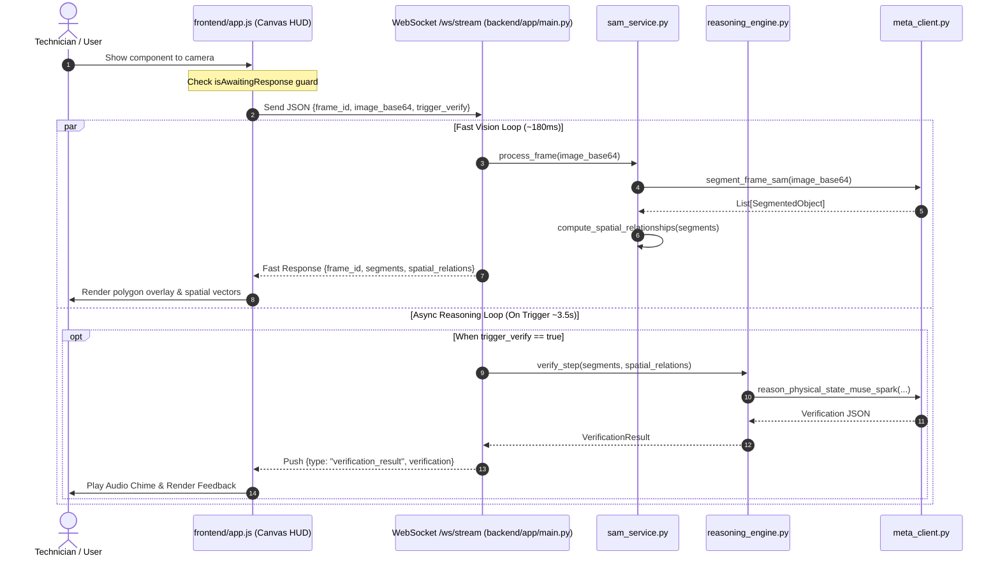

**Back:** [00-overview](./00-overview.md)

# Streaming Pipeline

## Data Lifecycle

The streaming pipeline processes real-time video frames using a Dual-Loop architecture:
1. **Fast Vision Stream:** Returns zero-shot SAM 3.1 masks and spatial vectors within ~150-250ms.
2. **Asynchronous Reasoning Stream:** Dispatches Muse Spark physical reasoning in a non-blocking background task upon explicit verification trigger.

## Protocol Characteristics
- **Transport:** WebSocket (`ws://` or `wss://`) over `/ws/stream`.
- **Payload Format:** JSON serialized string.
- **Client Render Loop:** Managed via `renderLoop(now)` in `frontend/app.js` using `requestAnimationFrame`.
- **Sampling Frequency:** Typically 4 to 5 frames per second.
- **Backpressure Handling:** Enforced by client-side `isAwaitingResponse` lock in `frontend/app.js`, dropping stale frames when backend is busy.
- **Demo Mode:** Built-in procedural scenario playback via `frontend/demo_clips.js`.

## Cross-References
- API message schemas: [docs/03-interfaces/websocket-protocol.md](../03-interfaces/websocket-protocol.md).
- Data models: [docs/04-configuration/data-schemas.md](../04-configuration/data-schemas.md).
