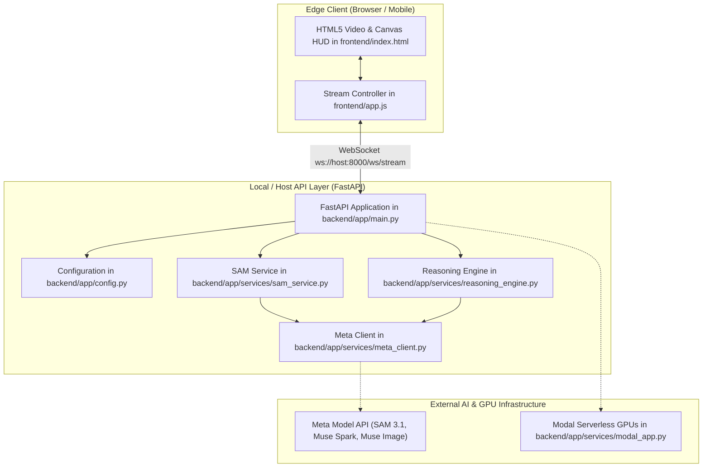

**Back:** [00-overview](./00-overview.md)

# System Topology

## Overview
OmniSpatial uses a hybrid edge-and-cloud architecture designed for real-time spatial computer vision and physical task guidance.

## Component Boundaries

1. **Edge Client (`frontend/`):**
   - Renders live video feeds via `navigator.mediaDevices.getUserMedia`.
   - Projects transparent HTML5 canvas overlays rendering SAM 3.1 polygon contours.
   - Communicates bi-directionally over WebSockets via `connectWebSocket()` in `frontend/app.js`.

2. **Core API Server (`backend/app/main.py`):**
   - Exposes REST endpoints (`GET /health`, `GET /api/steps`) and streaming endpoint (`WebSocket /ws/stream`).
   - Parses incoming JSON frame payloads via `backend/app/schemas/models.py`.
   - Coordinates the pipeline between `SAMService` and `ReasoningEngine`.

3. **External Inference Layer:**
   - **Meta Model API**: Zero-shot masks from SAM 3.1, structured physical reasoning from Muse Spark, and visual targets from Muse Image.
   - **Modal Serverless Worker**: High-throughput GPU execution defined in `backend/app/services/modal_app.py`.

## Cross-References
- For service-level details, see [docs/02-services/00-overview.md](../02-services/00-overview.md).
- For network protocol specifications, see [docs/03-interfaces/00-overview.md](../03-interfaces/00-overview.md).
